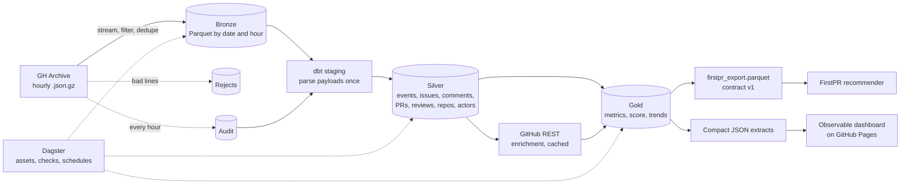

# OSS Pulse: measuring how newcomer-friendly open source really is

A production-style batch pipeline over [GH Archive](https://www.gharchive.org/). It computes
newcomer-friendliness metrics per repository, publishes them to a static dashboard, and exports a
versioned feature table for the FirstPR recommender.

**Dashboard:** _link to be added once GitHub Pages is enabled_

## The problem

"Good first issue" is a promise, and many projects don't keep it. Someone making a first
contribution wants to know whether a maintainer will answer, whether outside pull requests get
merged, and whether a labelled issue is really available. None of that shows on a repo page.

GH Archive records public GitHub events, so the answers should be computable. In practice the feed
changed underneath: `author_association`, PR authors, timestamps and merged flags have all gone,
and only a small sample of events is captured. Most of the engineering here is about getting
honest numbers out of that feed, and measuring how far they can be trusted.

## Architecture



Python 3.11, Dagster, DuckDB, dbt-core with dbt-duckdb, pytest, GitHub Actions and Observable
Framework. Everything is free to run.

## Scale

Numbers from the run over <!--m:window_start-->2026-10-06<!--/m--> to
<!--m:window_last_day-->2026-11-04<!--/m--> (the most recent complete days).

| Measure | Value |
| --- | --- |
| Hourly partitions ingested | <!--m:partitions_ok-->720<!--/m--> of <!--m:partitions_total-->720<!--/m--> |
| Events read | <!--m:rows_read-->20,595,692<!--/m--> |
| Events kept after filtering by type | <!--m:rows_kept-->4,786,152<!--/m--> |
| Downloaded, compressed | <!--m:gb_compressed-->6.00<!--/m--> GB |
| Processed, uncompressed | <!--m:gb_uncompressed-->27.74<!--/m--> GB |
| Repositories seen | <!--m:repos_seen-->1,590,019<!--/m--> |
| Repositories with human activity | <!--m:repos_human-->1,337,470<!--/m--> |
| Repositories enriched through REST | <!--m:repos_enriched-->869<!--/m--> |
| Repositories ranked | <!--m:repos_scored-->646<!--/m--> |
| Ingestion runtime | <!--m:ingest_seconds-->4,409.7<!--/m--> s on <!--m:ingest_workers-->6<!--/m--> workers |
| dbt, contract, extracts and report runtime, API cache warm | <!--m:build_seconds-->49.5<!--/m--> s |

## Data model

Bronze keeps the raw payload. Silver is rebuilt from it. Gold is what people and FirstPR read.

| Layer | Tables | Grain |
| --- | --- | --- |
| Bronze | `events`, `audit`, `rejects` | event, hourly partition, rejected line |
| Silver | `events` | event |
| Silver | `issues` | issue, latest observed state, with a labels array |
| Silver | `issue_comments` | comment |
| Silver | `pull_requests` | pull request, assembled from all events that mention it |
| Silver | `reviews` | review or diff comment |
| Silver | `repos`, `actors` | repository, account |
| Gold | `gold_repo_metrics` | repository |
| Gold | `gold_repo_scores`, `gold_score_scenarios`, `gold_score_sensitivity` | repository, repository by scenario, scenario |
| Gold | `gold_daily_trends`, `gold_repo_daily` | day, repository by day |
| Gold | `gold_response_summary`, `gold_response_distribution`, `gold_open_good_first_issues` | kind, kind by bucket, issue |
| Gold | `gold_bot_traffic`, `gold_partition_health`, `gold_pipeline_summary`, `gold_network_summary` | reporting |
| Gold | `firstpr_export` | repository, with open good first issues nested |

## Metric definitions

Exact definitions and edge cases are in [docs/metrics.md](docs/metrics.md). In short:

- **Maintainer:** `author_association` is no longer in the feed, so this falls back to the repo
  owner, the author of a PR from a same-repo branch, or someone who labelled or closed another
  person's issue. The association is used when an older payload has it.
- **External PR:** a fork PR from a non-maintainer.
- **First-time contributor:** an external PR author with no earlier observed activity in the repo
  during the window. This is a proxy, and it overstates first-timers.
- **First maintainer response:** first observed action by a maintainer on an item raised by a
  non-maintainer. Actions inside 60 seconds count as automation.
- **Merge rate:** merged / (merged + closed unmerged), over terminal events.
- **Good first issue pickup:** first comment, assignment or linked PR from a third party.
- **Newcomer friendliness score:** six percentile components with weights in
  [a seed file](dbt/seeds/score_weights.csv), renormalised over those a repo has evidence for.

## Findings

Bots are excluded unless stated, and every number below is checked against pipeline outputs by
`scripts/verify_readme.py`.

1. **The feed is a sample now.** Comment counters show about
   <!--m:capture_rate-->1.24%<!--/m--> of events are captured. Every count below is sampled, and
   per-repo figures rest on small numbers, which is why only
   <!--m:repos_scored-->646<!--/m--> of <!--m:repos_gate-->4,348<!--/m--> repositories that pass the
   activity gate also have enough evidence to rank.

2. **The actor on a merge event is not the person who merged.** It was the PR author in all
   <!--m:merged_actor_checked-->139<!--/m--> events checked against REST, including
   <!--m:merged_actor_not_merger-->15<!--/m--> where someone else merged. The obvious fallback,
   "whoever merged is a maintainer", would have labelled contributors as maintainers.

3. **About a quarter of the activity is automated.** Bots produced
   <!--m:bot_share-->26.2%<!--/m--> of events, including
   <!--m:bot_share_issue_comments-->56.4%<!--/m--> of issue and PR comments and
   <!--m:bot_share_review_comments-->53.6%<!--/m--> of diff comments, but only
   <!--m:bot_share_issues-->14.4%<!--/m--> of issue activity. The overall share moves with the
   mix of event types the feed captures, so the per-type figures are the steadier ones.

4. **Outsiders wait far longer to get merged.** The median external PR took
   <!--m:external_ttm_h-->18.9<!--/m--> hours (<!--m:external_ttm_samples-->870<!--/m--> PRs),
   against <!--m:branch_ttm_min-->15.5<!--/m--> minutes for same-repo branches
   (<!--m:branch_ttm_samples-->10,496<!--/m--> PRs). That is about
   <!--m:ttm_ratio-->73<!--/m--> times longer.

5. **External PRs mostly land, though less often than events suggest.** Events give an external
   merge rate of <!--m:external_merge_rate-->87.0%<!--/m--> over
   <!--m:external_resolved-->18,417<!--/m--> resolved PRs. REST ground truth for
   <!--m:true_resolved-->207<!--/m--> resolved PRs gives
   <!--m:true_merge_rate-->74.9%<!--/m--> because closes are under-captured, and
   <!--m:true_still_open_share-->27.4%<!--/m--> of sampled PRs were still open after three days.
   Trust the ranking more than the absolute rate.

6. **Most outside issues get no visible answer in the window.** Of
   <!--m:issue_items-->111,819<!--/m--> issues from non-maintainers, a maintainer response was
   observed on <!--m:issue_observed_share-->17.4%<!--/m--> (a floor). The median observed response
   was <!--m:issue_median_h-->18.7<!--/m--> hours with a p90 of
   <!--m:issue_p90_h-->197.2<!--/m--> hours. Where the comment counter proves it was the first
   comment (<!--m:issue_exact_items-->2,666<!--/m--> issues), the median was
   <!--m:issue_exact_median_h-->9.6<!--/m--> hours.

7. **Good first issues outnumber visible takers.** The window held
   <!--m:gfi_open-->4,930<!--/m--> open good first issues across
   <!--m:gfi_repos-->2,787<!--/m--> repositories. Of
   <!--m:gfi_measurable-->5,267<!--/m--> labelled in the window, a contributor action was observed
   on <!--m:gfi_pickups-->578<!--/m--> (<!--m:gfi_pickup_share-->11.0%<!--/m--> as a floor), with a
   median of <!--m:gfi_pickup_median_h-->41.4<!--/m--> hours.

8. **The ranking depends on what you value.** Against the baseline, rank correlation runs from
   <!--m:spearman_gfi_heavy-->0.943<!--/m--> when good first issues are emphasised to
   <!--m:spearman_health_heavy-->0.664<!--/m--> when activity health is. A
   response-heavy weighting keeps <!--m:top10_response_heavy-->7<!--/m--> of the top ten, and
   the median repository's rank moves by <!--m:rank_spread_median-->241<!--/m--> places across
   scenarios. Also, <!--m:single_maintainer_share-->50.1%<!--/m--> of ranked repositories had one
   visible maintainer or none, though low capture will overstate that.

## Data quality summary

The generated report is [docs/data_quality.md](docs/data_quality.md).

- **Coverage:** <!--m:partitions_missing-->0<!--/m--> partitions missing and
  <!--m:partitions_corrupt-->0<!--/m--> corrupt.
- **Rejects:** <!--m:rows_rejected-->127<!--/m--> lines, all events with no repository.
- **Duplicates:** <!--m:rows_duplicate-->216<!--/m--> removed.
- **Timestamps:** <!--m:timestamp_anomalies-->533<!--/m--> rows corrected. GitHub shifted embedded
  timestamps by an hour around the US daylight saving change, in REST as well as in events, so
  some issues appear to close before they were created.
- **Tests:** <!--m:dbt_tests_passed-->80<!--/m--> of <!--m:dbt_tests_total-->80<!--/m--> dbt tests
  and <!--m:pytest_passed-->103<!--/m--> pytest tests pass.
- **Feed stability:** branch and tag creation events arrive in bursts, absent on some days and the
  largest event type on others, so raw daily totals move with the feed. Pull request, issue and
  comment events are steadier, and almost no ranked repository needs creation events to clear the
  activity gate.
- **Maintainer rules against REST:** precision <!--m:maintainer_precision-->84.1%<!--/m--> on
  <!--m:maintainer_checked-->283<!--/m--> comments. Owner evidence was right
  <!--m:maintainer_owner_precision-->100.0%<!--/m--> of the time. The same-repo branch rule agrees
  with REST only <!--m:maintainer_push_precision-->48.1%<!--/m--> of the time, though a same-repo
  branch does need push access, so REST may be hiding private organisation membership. That
  explanation is unverified.
- **Known gap:** <!--m:maintainer_missed_share-->28.9%<!--/m--> of sampled comments from people
  not inferred as maintainers came from real maintainers, so "external" includes some insiders.

## How FirstPR consumes the export

`gold/firstpr_export.parquet` has one row per repository: every ranked repository, plus any active
repository with an open good first issue, for <!--m:export_repos-->2,926<!--/m--> repositories and <!--m:export_issues-->4,908<!--/m--> issues in this run. Its
schema, types, nullability and semantics are versioned in
[contracts/firstpr_export_v1.yml](contracts/firstpr_export_v1.yml).

FirstPR can filter on `language` and `topics`, order by `friendliness_score`, and walk the nested
`open_good_first_issues`. Sample-size columns sit beside each metric so it can discount thin
evidence. `friendliness_score` is null for repositories below the evidence gate, so those need a
fallback rank. `oss_pulse.contract.validate` can check any delivered file. Breaking changes go to a
new `firstpr_export_v2.yml`.

```python
import duckdb

duckdb.sql("""
    select repo_name, friendliness_score, unnest(open_good_first_issues).url as issue_url
    from 'data/gold/firstpr_export.parquet'
    where language = 'Python' and not archived and friendliness_score is not null
    order by friendliness_score desc
""")
```

## Repo structure

```text
.github/workflows/   ci.yml and the scheduled refresh.yml
contracts/           Versioned data contract for the FirstPR export
dashboard/           Observable Framework site and its committed JSON extracts
dbt/                 Seeds, staging, silver and gold models, and tests
docs/                Metrics, design decisions, quality report, deployment, interview prep
reports/             Run timing, test counts and REST validation results
scripts/             Fixture generation, fallback validation and README verification
src/oss_pulse/       Ingestion, enrichment, contract, extracts, CLI and Dagster definitions
tests/               pytest suite and synthetic GH Archive fixtures
DECISIONS.md         Every decision made during the build, with evidence
Makefile             setup, backfill, build, test, dashboard, all
```

## How to reproduce

Needs Python 3.11 through [uv](https://docs.astral.sh/uv/), Node 20 or later, and about 6 GB of
disk. `GITHUB_TOKEN` is optional and only enables enrichment.

```sh
make setup                  # Python environment, dashboard packages, .env
make backfill               # the most recent 30 complete days
make build                  # dbt, enrichment, contract, extracts, quality report
make test                   # pytest
make dashboard              # static site in dashboard/dist
make verify                 # recompute every README number
make all                    # all of the above
make dagster                # Dagster UI
make fixtures               # offline run over tests/fixtures, as in CI
```

Use `make backfill END=2026-11-04` to pin the window. To change its length, set `DAYS` for the
backfill and `window_days` in `dbt/dbt_project.yml` for the metrics, since `DAYS` alone only changes
what is ingested. Deployment steps are in [docs/deployment.md](docs/deployment.md).
